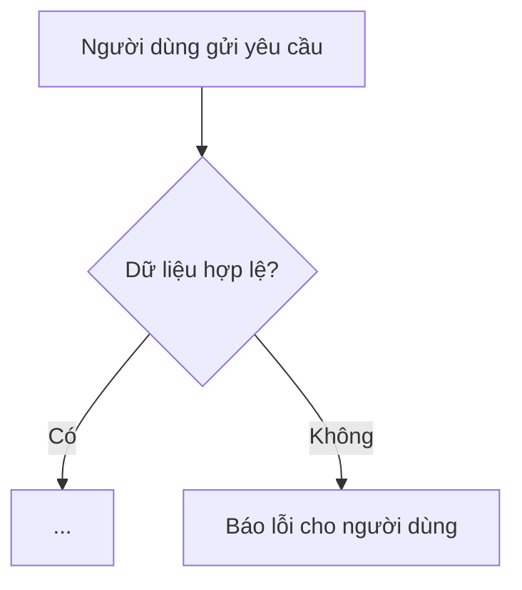

# Khuôn tài liệu luồng nghiệp vụ

Lưu tại `docs/business-flows/<slug>.md` (hoặc `--out`). Giữ đúng thứ tự và tên mục; mục không có nội dung thì ghi "Không có" kèm lý do, không xoá mục.

~~~markdown
# Luồng nghiệp vụ: <tên luồng>

> Cập nhật: YYYY-MM-DD · Độ sâu: service | data | external · Nguồn: source code tại commit <hash ngắn nếu có>

## 1. Phạm vi
- Luồng này làm gì, cho ai (1-3 câu).
- Điểm bắt đầu: <màn hình / endpoint / job / consumer>, mô tả bằng lời.
- Điểm kết thúc: kết quả nghiệp vụ khi thành công.
- Ngoài phạm vi: các luồng liên quan nhưng không mô tả ở đây.
- Mặc định đã chọn: độ sâu, nơi lưu (nếu người dùng không truyền).

## 2. Tác nhân
| Tác nhân | Vai trò trong luồng |
|---|---|

## 3. Sơ đồ

Nhãn node bằng ngôn ngữ nghiệp vụ. Mỗi điểm quyết định có đủ các nhánh.

## 4. Luồng chính
1. <bước, bằng ngôn ngữ nghiệp vụ>

## 5. Luồng thay thế
- **A1. <tên>**: điều kiện xảy ra → các bước khác với luồng chính.

## 6. Luồng lỗi
- **E1. <tên>**: điều kiện → hệ thống phản hồi gì → trạng thái dữ liệu sau lỗi.

## 7. Quy tắc nghiệp vụ
| Mã | Quy tắc | Áp dụng ở bước |
|---|---|---|
| R1 | ... | 4.2 |

## 8. Dữ liệu
- Thông tin đầu vào chính và ràng buộc (bắt buộc, định dạng, giới hạn).
- Dữ liệu được tạo / thay đổi, mô tả bằng lời (không dùng tên bảng).
- Trạng thái của đối tượng nghiệp vụ và cách chuyển trạng thái (nếu có).

## 9. Dành cho QA/QC
| Điểm quyết định / nhánh lỗi | Gợi ý kịch bản kiểm thử |
|---|---|

## 10. Câu hỏi còn mở
- [cần xác nhận với BA/dev] ...

## Phụ lục: truy vết
| Bước / quy tắc | Vị trí trong code (`file:line`) | Ghi chú |
|---|---|---|
~~~
